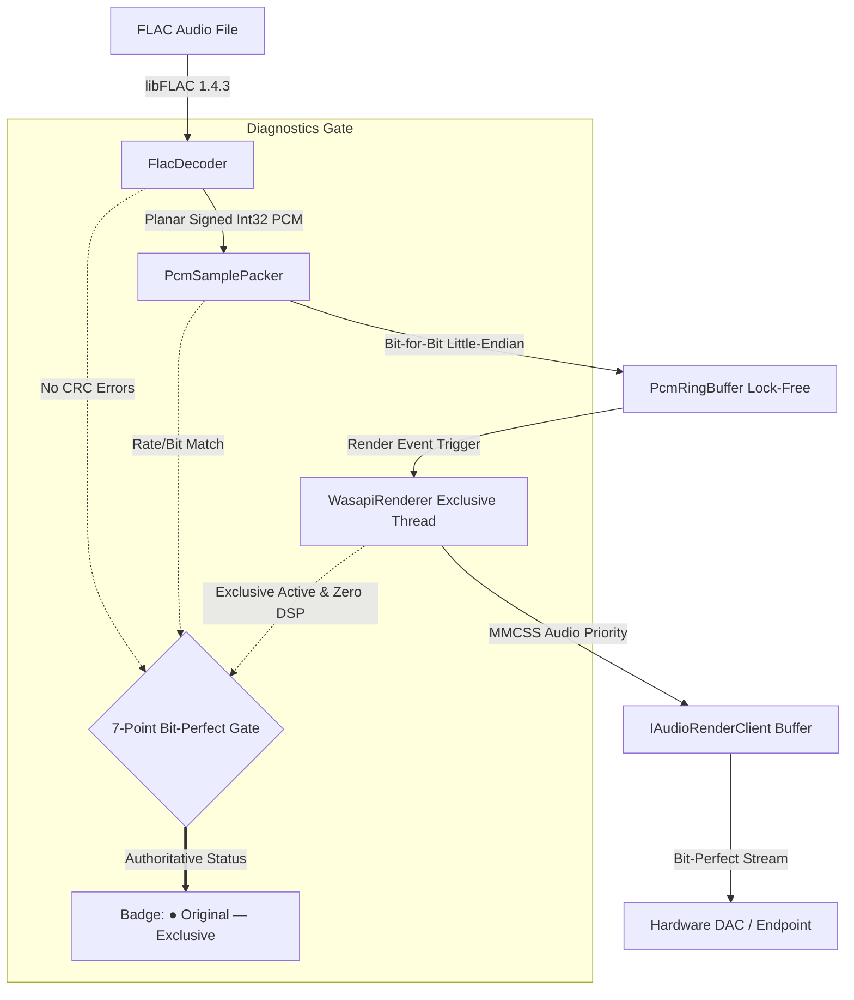
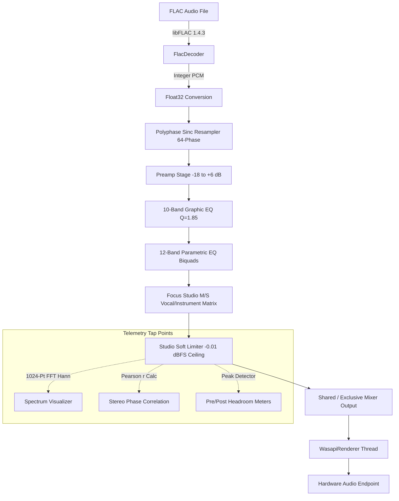

# HiResPlayer Signal Paths and Architectural Routing

This document details the exact signal routing, format conversions, tap points, and hardware arbitration mechanisms within **HiResPlayer**.

---

## 1. Architectural Routing Overview

HiResPlayer provides two distinct, mutually exclusive signal processing paradigms:

1. **Original / Reference Playback (`HP_EXCLUSIVE`):**
   - Untouched bit-perfect integer PCM streaming directly to the Windows WASAPI Exclusive endpoint.
   - Zero DSP, zero format conversion, zero digital gain, and zero resampling.
   - Confirmed by the 7-point hardware/stream verification gate.

2. **Studio DSP Engine (`HP_SHARED` or Processed Exclusive):**
   - 32-bit floating-point audio workstation pipeline.
   - Includes Graphic EQ (10-Band, $Q = 1.85$), Parametric EQ (12-Band biquad), Focus Studio (mid-side vocal/instrument focus), Master Preamp (-18 dB to +6 dB), and Studio Soft Limiter (-0.01 dBFS ceiling).
   - High-resolution polyphase resampling (Kaiser sinc, >100 dB alias rejection) when mixing rates differ.
   - Truthfully labeled in all diagnostics: `Studio DSP — Processed`.

---

## 2. Signal Path Diagrams

### Path A: Original / Reference (WASAPI Exclusive)

### Path B: Studio DSP Engine (32-Bit Float Pipeline)

---

## 3. Detailed Component Breakdown

### 3.1 FLAC Decoder & Input Representation
- **Decoder:** `libFLAC` version 1.4.3.
- **Decoding Thread:** Background worker (`PlaybackController::DecodeThreadProc`).
- **Data Delivery:** Planar signed 32-bit integers (`samples[channel][sample_index]`), where actual valid bits reside in the least-significant 16 or 24 bits.
- **Metadata Extraction:** Vorbis comment parsing (`TITLE`, `ARTIST`, `ALBUM`, `ALBUMARTIST`, `TRACKNUMBER`) and embedded FLAC picture extraction (front cover art).

### 3.2 Reference Signal Chain (Bypass Mode)
- **Condition:** Enabled when `HP_PlaybackMode.Exclusive` is active, EQ is bypassed, Preamp is at 0.0 dB, and Center Processor is disabled.
- **Conversion:** **None**. `pack_sample()` in `PcmSamplePacker.h` writes:
  - 16-bit FLAC $\to$ 16-bit signed integer little-endian (2 bytes per channel).
  - 24-bit FLAC $\to$ 24-in-32 signed integer (sample shifted left by 8, LSB padded with zeros) or packed 24-bit (3 bytes per channel) based on endpoint format negotiation.
- **Buffer:** Direct write to single-producer single-consumer lock-free `PcmRingBuffer`.
- **Latency / Period:** Hardware minimum device period negotiated via `IAudioClient::GetDevicePeriod(&defPeriod, &minPeriod)` (typically 3 ms to 10 ms).

### 3.3 Studio DSP Signal Chain
- **Condition:** Enabled when user engages Graphic EQ, Parametric EQ, Preamp gain, or Focus Studio.
- **Format:** Interleaved 32-bit IEEE single-precision float (`float*`) normalized to $[-1.0, +1.0]$.
- **Stages in Order:**
  1. **Polyphase Resampler:** Active if `SourceRate != OutputRate`. Kaiser-windowed 64-phase FIR filter providing -107.3 dB stopband alias rejection.
  2. **Preamp Gain:** Linear gain scaling: $g = 10^{\frac{\text{PreampDb}}{20}}$.
  3. **Graphic Equalizer:** 10 second-order IIR peaking biquad filters centered at ISO standard frequencies (31 Hz, 62 Hz, 125 Hz, 250 Hz, 500 Hz, 1 kHz, 2 kHz, 4 kHz, 8 kHz, 16 kHz) with $Q = 1.85$.
  4. **Parametric Equalizer:** 12 arbitrary biquad filters (Peaking, LowShelf, HighShelf, LowPass, HighPass, Notch) with parameter slewing.
  5. **Focus Studio (Mid/Side Matrix):**
     $$\text{Mid} = \frac{L + R}{\sqrt{2}}, \quad \text{Side} = \frac{L - R}{\sqrt{2}}$$
     - Vocal Focus: Boosts 300 Hz – 3.4 kHz formant band in $\text{Mid}$ by $+4.5\text{ dB} \times \text{intensity}$.
     - Instrumental Focus: Attenuates center channel by up to $-28\text{ dB}$ while preserving sub-bass (<300 Hz) and high air (>3.4 kHz).
     - Reconstruction:
       $$L' = \frac{\text{Mid}' + \text{Side}}{\sqrt{2}}, \quad R' = \frac{\text{Mid}' - \text{Side}}{\sqrt{2}}$$
  6. **Studio Soft Limiter:** Dual-stage brickwall saturation preventing numeric wrap or harsh digital clipping on loud peaks.

### 3.4 Telemetry and Diagnostic Tap Points
- **Spectrum Analyzer:** Output samples are tapped post-limiter into a lock-free 1024-sample FIFO buffer. The visualization thread applies a Hann window and computes a 1024-point Radix-2 Cooley-Tukey FFT, grouping energy into 32 logarithmic musical frequency bins.
- **Stereo Phase Correlation:** Evaluates the Pearson product-moment correlation coefficient over 2048 frames:
  $$r = \frac{\sum (L_i - \bar{L})(R_i - \bar{R})}{\sqrt{\sum (L_i - \bar{L})^2 \sum (R_i - \bar{R})^2}}$$
  Where $r = +1.0$ indicates mono/in-phase, $r = 0.0$ indicates wide stereo, and $r < 0$ indicates out-of-phase audio.
- **Pre/Post-DSP Peak Meters:** Tracks absolute maximum sample values before entering DSP and after limiting, calculating dynamic crest factor and headroom in real time.
